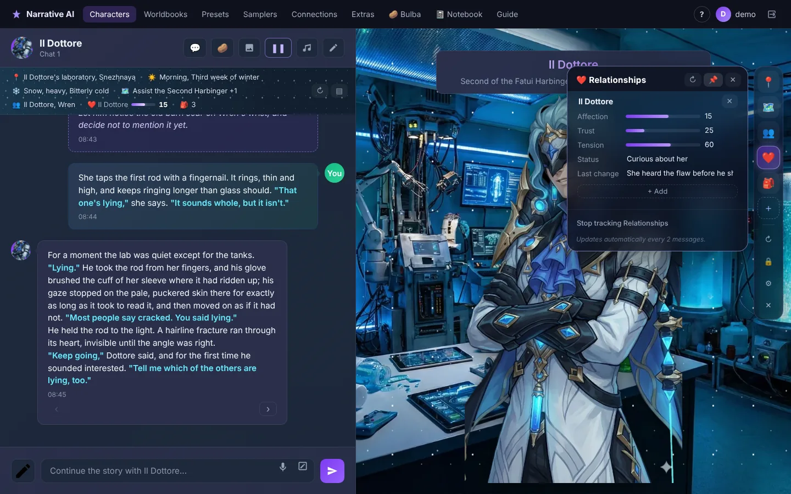
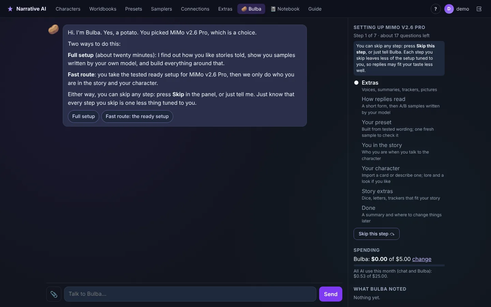
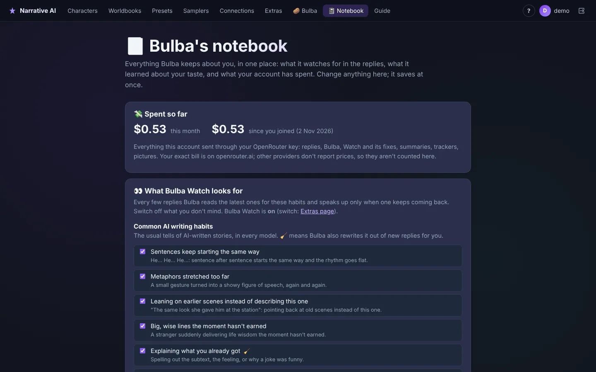
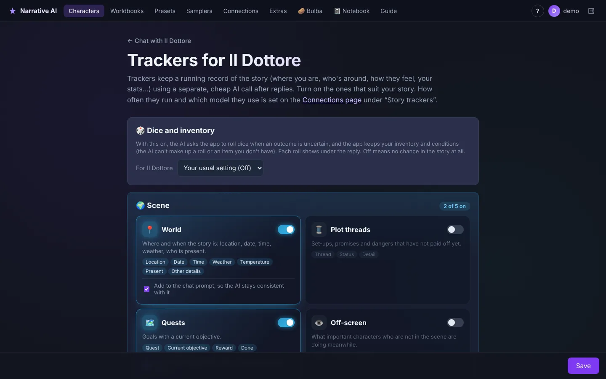
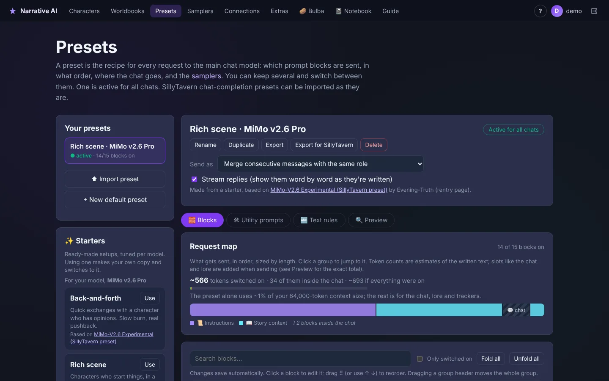
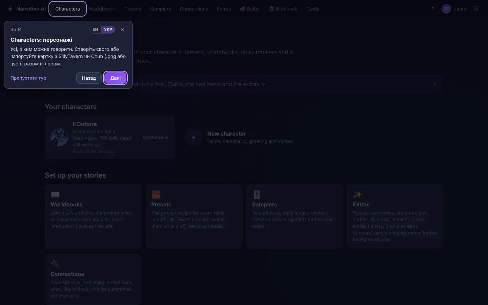

# NarrativeAI

NarrativeAI is a web app for creative writing and roleplay with AI characters, set up like a visual novel: character sprites that change with emotion, backgrounds, music and optional voiced replies. You bring your own AI key (OpenRouter or any OpenAI-compatible server, including local models), and the app takes care of the prompting, memory and story bookkeeping around the chat.



<table>
  <tr>
    <td width="50%"><br><b>Bulba</b> sets everything up with you, then fixes what bugs you in a chat.</td>
    <td width="50%"><br><b>Bulba's notebook</b>: the writing habits it watches for, your taste, your spending.</td>
  </tr>
  <tr>
    <td><br><b>Story trackers</b>: the app keeps the story's state for the AI.</td>
    <td><br><b>Presets</b>: tested starters per model, and every block editable.</td>
  </tr>
  <tr>
    <td colspan="2" align="center"><br><b>Guided tours</b> on every page, in English and Ukrainian.</td>
  </tr>
</table>

<sub>Screenshots from a local copy with a short sample scene. The demo character's sprites are fan art shipped with the demo.</sub>

## Features

- **Bulba**: a talking potato that sets the app up with you. The full setup (about twenty minutes) asks how you like stories, shows A/B samples written by your own model and builds the preset, your persona and a character; the fast route takes a tested setup for your model. In a chat, Bulba finds why replies go wrong (the preset, the card, the model's habits) and proposes one fix at a time, which you can edit, try on the last reply, apply and undo.
- **Bulba Watch and the notebook**: every few replies Bulba quietly reads the latest ones for AI writing habits that keep coming back, and can rewrite them out of new replies. Bulba's notebook shows what it watches for (common habits, your model's known ones, your own), what it learned about your taste, and what your account has spent.
- **Guided tours**: a spotlight tour on every page, a "What's this?" mode where Bulba explains anything you click, in English and Ukrainian.
- **Characters**: description, scenario, first message, creator notes, and a set of emotion sprites (neutral, happy, sad, angry...). The sprite changes to match each reply. There's an optional second character and per-character ElevenLabs voices.
- **Chat**: regenerate, continue, edit messages, a Director's Note to steer the next reply, magic-expand and spellcheck for your own messages, chat backgrounds and music.
- **Story summary**: condenses older events so long chats stay coherent. It runs when you press a button, or automatically every N messages.
- **Story trackers**: a separate, cheap AI call keeps a record of the story after replies. There are 14 trackers in 4 panels:
  - Scene: World, Plot threads, Quests, Off-screen
  - Characters: Present characters, Detailed clothing, Relationships, Secrets
  - You: Stats, Conditions, Inventory, Reputation, Achievements
  - Custom: your own fields

  The scene shows above the chat, and every tracker opens from an icon rail beside it, with animated meters. You can edit values, lock them so the AI can't change them, and switch a tracker off from the chat.
- **Worldbooks (lorebooks)**: SillyTavern-style entries that are added to the prompt when their keywords come up. Entries can have secondary keywords, always-on entries and priorities, and there's a "test a message" panel that shows what fires and why. You can import and export SillyTavern lorebooks and lorebooks embedded in character cards.
- **Connections**: several AI connections (keys and models). Each feature can use its own connection or model, for example an expensive model for the story and a cheap one for summaries and trackers.
- **Presets**: the recipe for every request, built from prompt blocks you can switch on and off, edit, reorder and group. Blocks can sit at a fixed spot or inside the chat at a chosen depth. Macros like `{{char}}`, `{{random}}` and `{{setvar}}`/`{{getvar}}` are supported. SillyTavern presets import and export as they are, and a preview shows exactly what will be sent. One preset is active for all chats.
- **Text rules (regex scripts)**: find-and-replace rules that come with SillyTavern presets and cards. They can change only what you see (turning tracker blocks into panels), only what's sent back to the AI (dropping old blocks or leaked thinking), or the saved message. Manage them in the preset's **Text rules** tab.
- **Character cards**: import SillyTavern cards (.png or .json), with their lore, alternate greetings and picture, and export your characters the same way.
- **Samplers** (part of the active preset): response length, context size, temperature, top-p/k, min-p, penalties, reasoning effort and more. Each one can be switched on or off. The app skips the ones a model would reject.

## Running it on your computer

### What you need

- **Python 3.11.** Check by running `python --version`; on macOS and Linux the command may be `python3`. Get Python from [python.org](https://www.python.org/downloads/).
- **Git**, to download the code. Or use GitHub's green **Code → Download ZIP** button.
- **An AI key.** [OpenRouter](https://openrouter.ai/keys) is the easiest: one key gives you most models. Any OpenAI-compatible server works too, including local ones like koboldcpp or llama.cpp.
- *Optional:* an [ElevenLabs](https://elevenlabs.io) key and **ffmpeg** for voiced replies. To install ffmpeg:
  - macOS: `brew install ffmpeg`
  - Ubuntu/Debian: `sudo apt install ffmpeg`
  - Windows: `winget install ffmpeg`

### Setup (first time)

Run these in a terminal (on Windows: PowerShell or Command Prompt).

**1. Get the code and go into its folder**

```shell
git clone https://github.com/PineapplePatriot/NarrativeAI.git
cd NarrativeAI
```

**2. Create a virtual environment** (a private box of Python packages just for this project)

```shell
python -m venv venv
```

**3. Turn it on.** You need to do this every time you open a new terminal for this project.

macOS / Linux:
```shell
source venv/bin/activate
```
Windows (PowerShell):
```shell
venv\Scripts\Activate.ps1
```
Windows (Command Prompt):
```shell
venv\Scripts\activate.bat
```

When it's on, your prompt starts with `(venv)`.

**4. Install the packages**

```shell
pip install -r requirements.txt
```

*Optional:* meaning-based ("semantic") worldbook search. This is a large download (PyTorch), and you only need it if you turn on "Semantic search" in a worldbook's settings. Keyword matching works without it.

```shell
pip install -r requirements-semantic.txt
```

**5. Create the database**

```shell
cd narrative
python manage.py migrate
```

**6. Start the app**

```shell
python manage.py runserver
```

Open **http://127.0.0.1:8000** in your browser. To stop the app, press `Ctrl+C` in the terminal.

### Next time

```shell
cd NarrativeAI
source venv/bin/activate        # Windows: venv\Scripts\activate
cd narrative
python manage.py runserver
```

### After pulling new changes

New code sometimes adds packages or database changes. Run these (with the venv on) before starting:

```shell
pip install -r requirements.txt
cd narrative
python manage.py migrate
```

## First steps in the app

1. **Create an account** with the link under the login form.
2. **Connections:** paste your API key, pick a model and press **Save**. The app sends you here automatically if you open a chat without a connection. This page is also where you choose cheaper models for summaries, trackers and emotion detection.
3. **Characters:** create a character (name, description, first message, sprites) and start chatting.
4. *Optional:*
   - **Worldbooks:** create or import a lorebook, then attach it to a character on the character's edit page.
   - **Trackers:** in the chat, open the tools menu (pencil button) and choose **⚙ Setup** under Story trackers.
   - **Presets:** open **Presets** in the top menu to choose which prompt blocks are sent, edit them, or import a SillyTavern preset. Your first preset, "NarrativeAI Default", is created automatically.
   - **Samplers:** open **Samplers** in the top menu. Everything starts switched off, which means the model uses its own defaults.

## Running the tests

```shell
cd narrative
python manage.py test
```

The tests use a fake AI, so they need no API key and cost nothing.

### Trying the whole app without OpenRouter

Two settings, only for testing, let the app talk to a stand-in server that pretends to be OpenRouter
(for example one that answers by hand or with canned replies). Leave both unset normally.

- `NARRATIVE_OPENROUTER_URL`: where "OpenRouter" requests go instead, e.g. `http://127.0.0.1:8899/api/v1`.
- `NARRATIVE_AI_TIMEOUT`: how many seconds to wait for every AI answer (useful when someone answers by hand).

## Project layout

```
narrative/                  Django project (run manage.py from here)
├── narrative/              settings and main URL routes
├── users/                  accounts, profile and persona, Connections page
│   └── models.py           ApiConfig (ElevenLabs), ConnectionProfile, TaskSetting
├── mainapp/                everything about characters and chatting
│   ├── views.py            chat page and its actions (send, regenerate, summary, trackers...)
│   ├── utils.py            builds the prompt for the main chat; voice generation
│   ├── ai_client.py        the only code that calls AI providers; per-feature model routing
│   ├── lorebook.py         worldbook matching engine, SillyTavern import/export
│   ├── trackers.py         story tracker definitions, AI update prompt, merging with locks
│   ├── presets.py          presets: block format, macros, request assembly, SillyTavern import/export
│   ├── samplers.py         sampler settings and context trimming
│   ├── model_profiles.py   what each model does with each setting (reads data/models/)
│   ├── starters.py         ready-made presets per model (reads data/starters/)
│   ├── chats.py            several chats per character: files, branches, swipes, summary pieces
│   ├── data/               built-in prompt library the default preset is made from
│   │   ├── models/         one profile per model: accepted settings, sources, style notes
│   │   └── starters/       ready-made presets per model (Back-and-forth, Rich scene, Director seat)
│   ├── tests.py            automated tests
│   ├── templates/          pages (HTML)
│   └── static/             page scripts (JS) and styles (CSS)
└── media/                  your uploads and chat logs (created on first run, not in git)
docs/bulba/                 the setup assistant (Bulba): research package and build plan
Prompting EI Testing/       prompt-style experiments (EQ-Bench based) and their report
requirements.txt            packages the app needs
requirements-semantic.txt   optional packages for semantic worldbook search
```

Chats are saved as JSON files in `narrative/media/chat_logs/`. The database is `narrative/db.sqlite3`. Both stay on your computer and are not uploaded to git.

## Troubleshooting

- **`python` is not found:** try `python3` instead (macOS/Linux), or reinstall Python and tick "Add Python to PATH" (Windows).
- **PowerShell says running scripts is disabled:** run `Set-ExecutionPolicy -Scope CurrentUser RemoteSigned` once, then activate again.
- **`No module named django`:** the virtual environment isn't on. Do step 3 again.
- **The chat shows an error in red:** the message names the problem (wrong key, unknown model, the provider is down...). Fix it on the Connections page, then press Regenerate. Your message is kept.
- **Voices don't play:** check your ElevenLabs key on the Connections page and that ffmpeg is installed.

## Note

This setup is for running the app on your own computer. It uses Django's development server, a built-in secret key and debug mode, which are not safe for putting the app on the internet as is.
